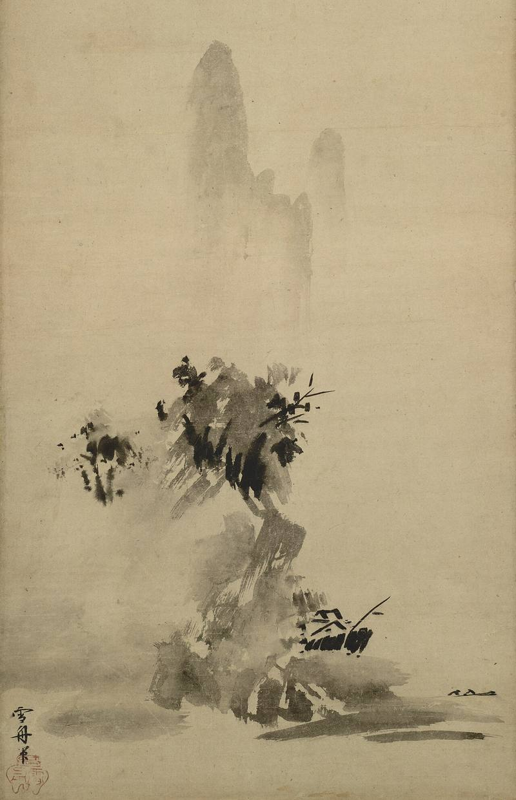
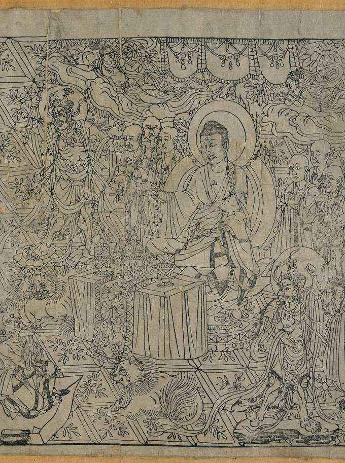
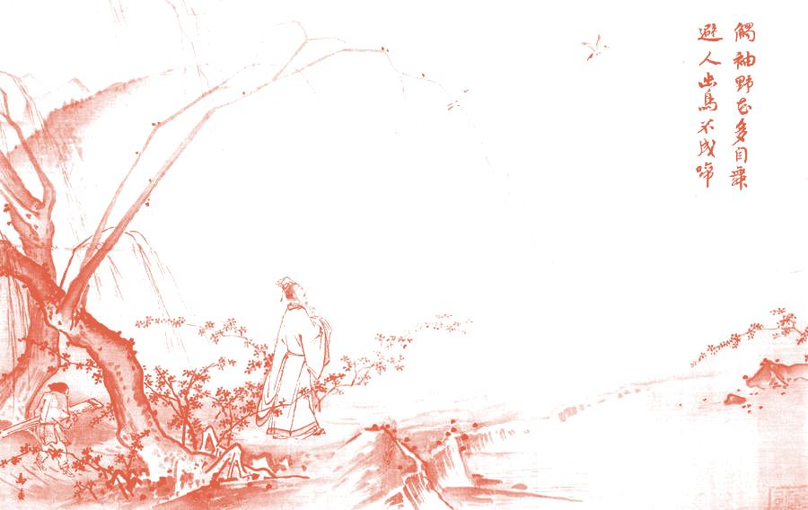
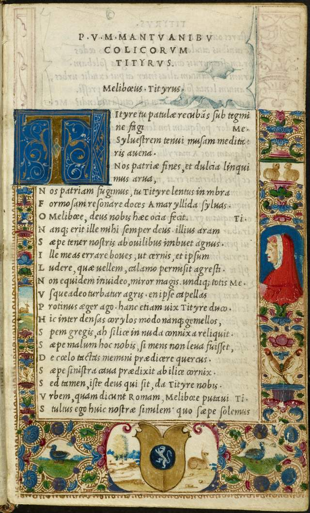
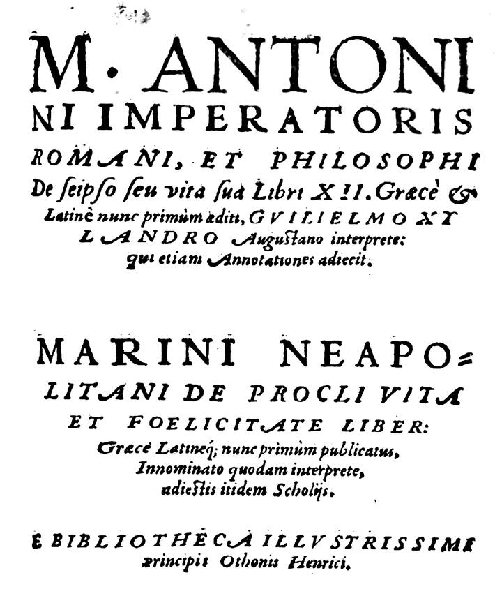

<header class="rs-head">

There is the leisurely one, Walking the Tao, beyond philosophy,

The first lines of the <a href="/shodoka"><em>Shodoka</em></a>, a Zen song. The rest takes twenty minutes.

</header>

<article class="rs-text">

Sutras is a small library of texts worth reading slowly, from Zen poems to the Stoics. Each is here complete and free, with a link to every passage and an EPUB; most have notes in the margin.

<ul class="sd-shelf">
<li><a href="/faith-in-mind"><h3>Faith in Mind</h3>Zen · a poemSeng Ts’an, attributed · translated by Master Sheng-yen with Paul Kennedy · ten minutesA poem on the mind that does not pick and choose. The shortest text in the library.</a></li>
<li><a href="/shodoka"><h3>Shodoka</h3>Zen · a songYung-chia, attributed · translated by Robert Aitken and Eido Shimano · twenty minutesSung in the first person by someone who has woken up and wants you to stop looking elsewhere.</a></li>
<li><a href="/gateless-gate-mumonkan"><h3>The Gateless Gate</h3>Zen · koansWumen Huikai · translated by Katsuki Sekida · an hour or two48 koans with the Chinese, each with his comment and verse, beginning with Jōshū’s “Mu”. Made for one case at a time.</a></li>
<li><a href="/diamond"><h3>The Diamond Sutra</h3>Mahayana · a sutraTranslated by Thich Nhat Hanh · half an hourThe Buddha and Subhuti: free all beings, and hold to no idea of self, of beings, or even of the teaching.</a></li>
<li><a href="/diamond-red-pine"><h3>The Diamond Sutra</h3>Mahayana · a sutraTranslated by Red Pine · about forty minutesThe same sutra, from the Sanskrit. For years Red Pine was told it was about emptiness; translating it, he decided it was about bodies.</a></li>
<li><a href="/dhammapada"><h3>Dhammapada</h3>Early Buddhism · versesThe Buddha, attributed · translated by Thanissaro Bhikkhu · two hours423 short verses from the Pāli Canon, with the translator’s notes at the verses they discuss.</a></li>
<li><a href="/tao-te-ching"><h3>Tao Te Ching</h3>Taoism · a classicLaozi, attributed · translated by James Legge, 1891 · about forty minutes81 short chapters, most only a few lines, with the Chinese beside each. Water takes the low place, and so is near to the Tao.</a></li>
<li><a href="/seneca-on-the-shortness-of-life"><h3>On the Shortness of Life</h3>Stoicism · an essaySeneca · translated by John W. Basore · about an hourLife is long enough, if we stop wasting it.</a></li>
<li><a href="/meditations"><h3>Meditations</h3>Stoicism · a journalMarcus Aurelius · translated by Gregory Hays · four or five hoursNotes to himself, in Greek, written as he ruled Rome and fought on its northern frontier. Rufus Pollock’s own notes are in the margin.</a></li>
</ul>

---

Every passage has a number that links to it and does not change. On most texts, notes sit in the margin beside the passage they are about: the translator’s, ours, and on *Meditations* Rufus Pollock’s own. Five translations of five chapters of the Tao Te Ching stand [side by side](/tao-te-ching-compared). Each text is also an EPUB, from its own page.

Sutras is made by Rufus Pollock, with AI assistants, as part of [Life Itself](https://lifeitself.org). More, including the copyright of each translation, is on the [about page](/about); the source is [on GitHub](https://github.com/life-itself/sutras).

</article>

