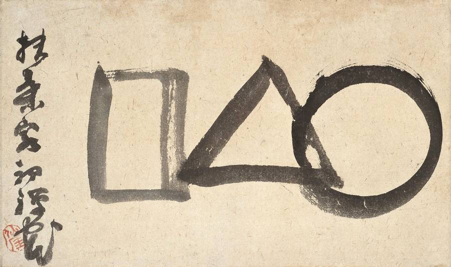

<header class="rs-head">

Sutras

The Supreme Way is not difficult If only you do not pick and choose.

Seng Ts’an, attributed · translated by Master Sheng-yen with Paul Kennedy

</header>

<article class="rs-text">

Sutras is a small library of wisdom texts, from Zen poems to the Stoics. Each text is complete and free to read. Every line has a number you can link to, and notes sit in the margin. Each text is also an EPUB. It is curated, not comprehensive: each is here because it is worth reading slowly.

<a href="/faith-in-mind">Start with <em>Faith in Mind</em></a>, about 10&nbsp;minutes. Or see <a href="#zen-chan">the whole shelf</a>.

## Zen (Ch’an)

<ul class="sd-shelf">
<li><a href="/faith-in-mind"><h3>Faith in Mind</h3>Seng Ts’an, attributed · translated by Master Sheng-yen with Paul Kennedy · about 10&nbsp;minA short poem on the mind that does not pick and choose.</a></li>
<li><a href="/shodoka"><h3>Shodoka</h3>Yung-chia · translated by Robert Aitken and Eido Shimano · about 15&nbsp;minSixty-four verses on seeing one’s own nature, sung in the first person by someone who has woken up.</a></li>
<li><a href="/gateless-gate-mumonkan"><h3>The Gateless Gate</h3>Wumen Huikai (Mumon Ekai) · translated by Katsuki Sekida · about 45&nbsp;minForty-eight koans, each with a comment and a verse by Wumen, beginning with Jōshū’s “Mu”. With the Chinese.</a></li>
</ul>

## Mahayana Buddhism

<ul class="sd-shelf">
<li><a href="/diamond"><h3>The Diamond Sutra</h3>Translated by Thich Nhat Hanh · about 30&nbsp;minThe Buddha and Subhuti on freeing all beings while holding on to no idea of self, of beings, or even of the teaching.</a></li>
<li><a href="/diamond-red-pine"><h3>The Diamond Sutra, Red Pine’s translation</h3>Translated by Red Pine (Bill Porter) · about 35&nbsp;minThe same sutra from the Sanskrit, keeping its repetitions and its full closing verse.</a></li>
</ul>

## Early Buddhism

<ul class="sd-shelf">
<li><a href="/dhammapada"><h3>The Dhammapada</h3>Translated by Thanissaro Bhikkhu · about 110&nbsp;min423 short verses from the Pāli Canon, attributed to the Buddha, on the mind and the path.</a></li>
</ul>

## Stoicism

<ul class="sd-shelf">
<li><a href="/seneca-on-the-shortness-of-life"><h3>On the Shortness of Life</h3>Seneca · translated by John W. Basore · about 50&nbsp;minLife is long enough, if we stop wasting it.</a></li>
<li><a href="/meditations"><h3>Meditations</h3>Marcus Aurelius · translated by Gregory Hays · about 235&nbsp;minA Roman emperor’s notes to himself on how to live, with Rufus Pollock’s notes in the margin.</a></li>
</ul>

## How to read here

**Every line has a number.** Click it to get a link to that line, such as [/faith-in-mind#1](/faith-in-mind#1) or [/meditations#1.1](/meditations#1.1). A number does not change once it is published.

**Notes sit in the margin,** beside the passage they are about: the translator’s, the editors’, and on *Meditations*, Rufus Pollock’s own.

**Each text is also an EPUB,** downloadable from its page for an e-reader.

## About

Sutras is made by Rufus Pollock with AI assistants, as part of [Life Itself](https://lifeitself.org). Who it is for, what is and is not here, and the copyright of each translation are on the [about page](/about).

<a href="/about">About Sutras</a> · <a href="https://github.com/life-itself/sutras">Source on GitHub</a>

</article>

