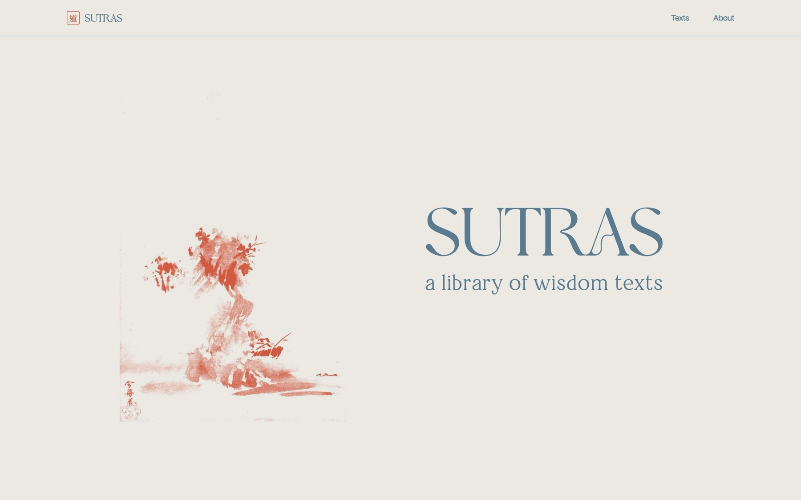
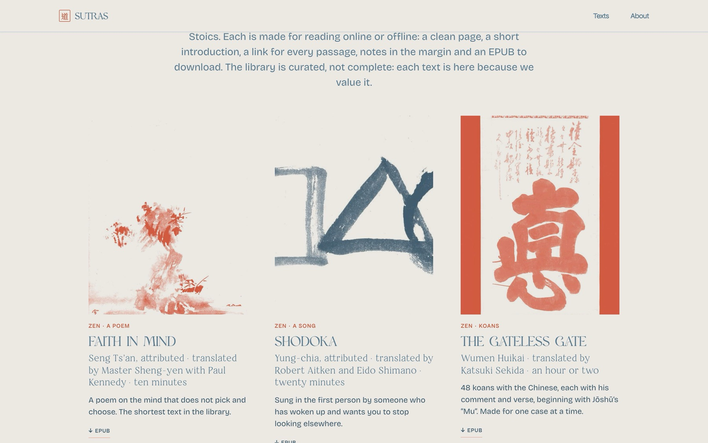
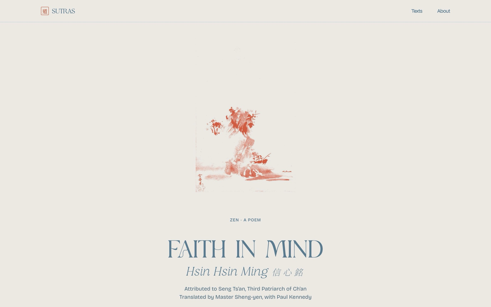
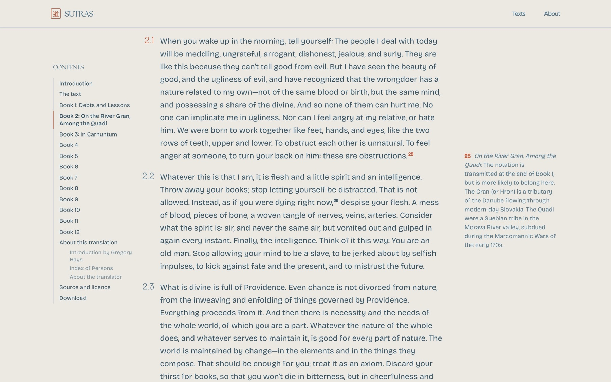
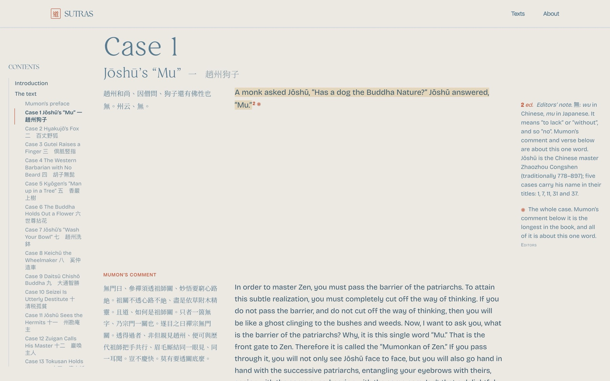
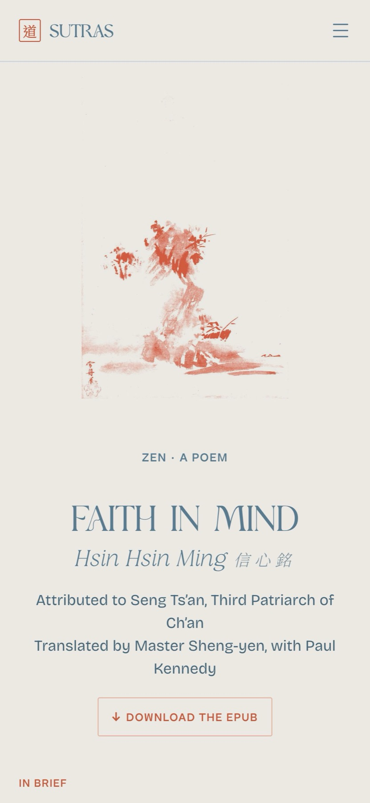

[Sutras](https://sutras.lifeitself.org) is back, rebuilt from the ground up as a small library of wisdom texts, from Buddhist sutras and Zen poems to the Stoics. Each text is made for reading online or offline: a clean page, a short introduction, a link for every passage, notes in the margin and an EPUB to download.

**Nine texts, three of them new.** Joining [Faith in Mind](https://sutras.lifeitself.org/faith-in-mind), the [Shodoka](https://sutras.lifeitself.org/shodoka), [The Gateless Gate](https://sutras.lifeitself.org/gateless-gate-mumonkan), the Diamond Sutra in two translations ([Thich Nhat Hanh](https://sutras.lifeitself.org/diamond) and [Red Pine](https://sutras.lifeitself.org/diamond-red-pine)) and Seneca's [On the Shortness of Life](https://sutras.lifeitself.org/seneca-on-the-shortness-of-life):

- [Dhammapada](https://sutras.lifeitself.org/dhammapada): all 423 verses in Thanissaro Bhikkhu's translation, with his notes beside the verses they discuss.
- [Meditations](https://sutras.lifeitself.org/meditations): Marcus Aurelius in Gregory Hays's translation, all twelve books, with our own notes in the margin.
- [Tao Te Ching](https://sutras.lifeitself.org/tao-te-ching): Legge's 1891 translation with the Chinese beside each of the 81 chapters, and a page that [compares translations](https://sutras.lifeitself.org/tao-te-ching-compared) of five chapters: five older ones in full and short samples of six modern ones, Red Pine's first.

**Made to read.** A new design takes its lead from Emergence Magazine's page for Red Pine: warm paper, one ink painting per text toned in coral or slate, the title set large, and the text in a calm, narrow column. Every page has a contents rail that follows you down the text.

**Notes in the margin, a link for every passage.** Notes sit beside the line they are about, and open on tap on a phone. Every verse, stanza or section has a number you can link to, such as [/meditations#4.3](https://sutras.lifeitself.org/meditations#4.3), and it will not change.

**The Chinese beside the English.** On a wide screen, the Gateless Gate sets each koan's Chinese beside Sekida's translation.

**An EPUB for every text.** Each page has a download button, and the books are rebuilt automatically whenever a text changes.

Also:

- Each text was checked against its source, and each has a short new introduction and a note on where it comes from and its copyright.
- A new [About page](https://sutras.lifeitself.org/about) explains what the library is and who it is for.
- The images and their sources are listed on a [credits page](https://sutras.lifeitself.org/credits).
