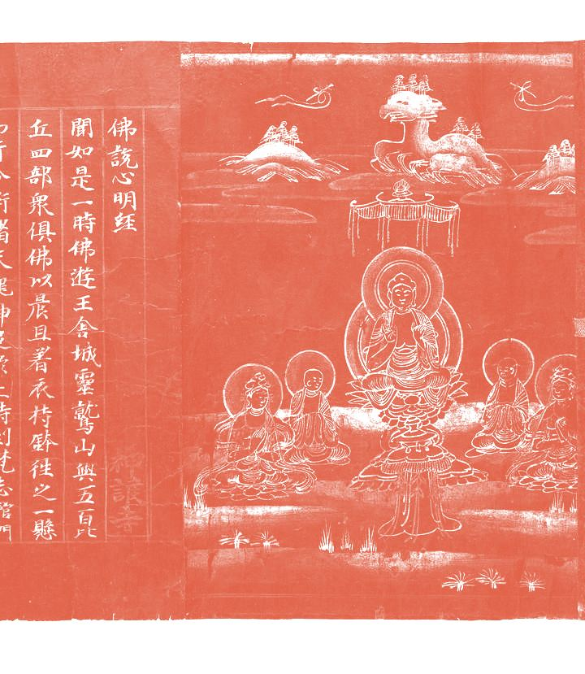

<figure class="sd-art"></figure>
<header class="rs-head">

Mahayana · a sutra
<h1>The Diamond Sutra</h1>

The Perfection of Wisdom <i>Vajracchedikā Prajñāpāramitā</i> 金剛經

Translated by Red Pine Also in this library: <a href="/diamond">Thich Nhat Hanh’s translation</a>

<a href="/downloads/diamond-red-pine.epub">Download the EPUB</a>

</header>

<nav class="rs-rail" aria-label="Contents">Contents<ol class="rs-toc" data-rs-auto></ol></nav><article class="rs-text">

In brief The Buddha’s answer to his disciple Subhuti on how to set out on the path to awakening: free all beings, and cling to nothing, not even the teaching. Complete, all 32 chapters, in Red Pine’s translation from the Sanskrit; about forty minutes to read.

## Introduction

The *Diamond Sutra* was composed in India by an unknown author some time between the second and fifth centuries CE. This is the second translation of it in this library. For the sutra itself, and the plainer English, start with [Thich Nhat Hanh’s](/diamond). This one is for readers who want the shape of the Sanskrit text: the Buddha’s titles in full, the same question put again and again, and the closing verse with all nine of its images.

Red Pine is the pen name of Bill Porter (born 1943), an American translator of Chinese Buddhist and Taoist texts. He translated the sutra from the Sanskrit and, he writes, compared all six Chinese translations. For years, he writes, he had been told it was about emptiness; the Sanskrit changed his mind. “It turns out the sutra isn’t about emptiness. Or at least, it isn’t emptiness that distinguishes this sutra. It’s about bodies, beginning with the Buddha’s body and ending with the body of every noble son or daughter who practices this teaching.” In his book each chapter is followed by his own remarks and the words of several dozen commentators, from Asanga to Hui-neng; only the sutra is here.

He writes that it “can be read in half an hour”. Read it once straight through, aloud if you can, since its meaning, he says, “still depended on its poetry”; then a chapter at a time. The five notes are ours, mostly quoting his commentary. The two translations use the same 32 chapters, so [/diamond-red-pine#14](/diamond-red-pine#14) and [/diamond#14](/diamond#14) are the same passage.

Editors’ introduction. November 2026.

## The sutra

<a class="v" id="1" href="#1">1</a>
Thus have I heard: Once the Bhagavan[^1] was dwelling near Shravasti at Anathapindada Garden in Jeta Forest together with the full assembly of 1250 bhikshus and a great many fearless bodhisattvas.[^2]

One day before noon, the Bhagavan put on his patched robe and picked up his bowl and entered the capital of Shravasti for offerings. After begging for food in the city and eating his meal of rice, he returned from his daily round in the afternoon, put his robe and bowl away, washed his feet, and sat down on the appointed seat. After crossing his legs and adjusting his body, he turned his awareness to what was before him.

A number of bhikshus then came up to where the Bhagavan was sitting. After touching their heads to his feet, they walked around him to the right three times and sat down to one side.

<a class="v" id="2" href="#2">2</a>
On this occasion, the venerable Subhuti was also present in the assembly. Rising from his seat, he uncovered one shoulder and touched his right knee to the ground. Pressing his palms together and bowing to the Buddha, he said: “It is rare, Bhagavan, most rare, indeed, Sugata, how the Tathagata, the Arhan, the Fully-Enlightened One blesses fearless bodhisattvas with the best of blessings. And it is rare, Bhagavan, how the Tathagata, the Arhan, the Fully-Enlightened One entrusts fearless bodhisattvas with the greatest of trusts.

“Even so, Bhagavan, if a noble son or daughter should set forth on the bodhisattva path, how should they stand, how should they walk, and how should they control their thoughts?”

The Buddha told the venerable Subhuti, “Well said, Subhuti. Well said. So it is, Subhuti. It is as you say. The Tathagata blesses fearless bodhisattvas with the best of blessings and entrusts fearless bodhisattvas with the greatest of trusts. You should therefore truly listen, Subhuti, and consider this well. I shall tell you how those who set forth on the bodhisattva path should stand, how they should walk, and how they should control their thoughts.”

The venerable Subhuti answered, “May it be so, Bhagavan,” and gave his full attention.

<a class="v" id="3" href="#3">3</a>
The Buddha said to him, “Subhuti, those who would now set forth on the bodhisattva path should thus give birth to this thought: ‘However many beings there are in whatever realms of being might exist, whether they are born from an egg or born from a womb, born from the water or born from the air, whether they have form or no form, whether they have perception or no perception or neither perception nor no perception, in whatever conceivable realm of being one might conceive of beings, in the realm of complete nirvana I shall liberate them all. And though I thus liberate countless beings, not a single being is liberated.’

“And why not? Subhuti, a bodhisattva who creates the perception of a being cannot be called a ‘bodhisattva.’ And why not? Subhuti, no one can be called a bodhisattva who creates the perception of a self or who creates the perception of a being, a life, or a soul.”

<a class="v" id="4" href="#4">4</a>
“Moreover, Subhuti, when bodhisattvas give a gift, they should not be attached to a thing. When they give a gift, they should not be attached to anything at all. They should not be attached to a sight when they give a gift. Nor should they be attached to a sound, a smell, a taste, a touch, or a dharma when they give a gift. Thus, Subhuti, fearless bodhisattvas should give a gift without being attached to the perception of an object. And why? Subhuti, the body of merit of those bodhisattvas who give a gift without being attached is not easy to measure. What do you think, Subhuti, is the space to the east easy to measure?”

Subhuti replied, “No, it is not, Bhagavan.”

The Buddha said, “Likewise, is the space to the south, to the west, to the north, in between, above, below, or in any of the ten directions easy to measure?”

Subhuti replied, “No, it is not, Bhagavan.”

The Buddha said, “So it is, Subhuti. The body of merit of those bodhisattvas who give a gift without being attached is not easy to measure. Thus, Subhuti, those who set forth on the bodhisattva path should give a gift without being attached to the perception of an object.”

<a class="v" id="5" href="#5">5</a>
“What do you think, Subhuti, can the Tathagata be seen by means of the possession of attributes?”

Subhuti replied, “No, indeed, Bhagavan, the Tathagata cannot be seen by means of the possession of attributes. And why not? Bhagavan, what the Tathagata says is the possession of attributes is no possession of attributes.”

This having been said, the Buddha told the venerable Subhuti, “Since the possession of attributes is an illusion, Subhuti, and no possession of attributes is no illusion, by means of attributes that are no attributes the Tathagata can, indeed, be seen.”

<a class="v" id="6" href="#6">6</a>
This having been said, the venerable Subhuti asked the Buddha, “Bhagavan, will there be any beings in the future, in the final epoch, in the final period, in the final five hundred years of the dharma-ending age, who give birth to a perception of the truth of the words of a sutra such as that spoken here?”

The Buddha said, “Subhuti, do not ask, ‘Will there be any beings in the future, in the final epoch, in the final period, in the final five hundred years of the dharma-ending age, who give birth to a perception of the truth of the words of a sutra such as that spoken here?’ Surely, Subhuti, in the future, in the final epoch, in the final period, in the final five hundred years of the dharma-ending age, there will be fearless bodhisattvas who are capable, virtuous, and wise who give birth to a perception of the truth of the words of a sutra such as that spoken here.

“Indeed, Subhuti, such fearless bodhisattvas will have honored not just one buddha, and they will have planted auspicious roots before not just one buddha. Surely, Subhuti, such fearless bodhisattvas will have honored countless hundreds and thousands of buddhas, and they will have planted auspicious roots before countless hundreds and thousands of buddhas. In the words of a sutra such as that spoken here, they are sure to gain perfect clarity of mind. The Tathagata knows them, Subhuti, by means of his buddha knowledge. And the Tathagata sees them, Subhuti, by means of his buddha vision. The Tathagata is aware of them, Subhuti. For they all produce and receive a measureless, infinite body of merit.

“And how so? Because, Subhuti, these fearless bodhisattvas do not create the perception of a self. Nor do they create the perception of a being, a life, or a soul. Nor, Subhuti, do these fearless bodhisattvas create the perception of a dharma, much less the perception of no dharma. Subhuti, they do not create a perception nor no perception.

“And why not? Because, Subhuti, if these fearless bodhisattvas created the perception of a dharma, they would be attached to a self, a being, a life, and a soul. Likewise, if they created the perception of no dharma, they would be attached to a self, a being, a life, and a soul.

“And why not? Because surely, Subhuti, fearless bodhisattvas do not cling to a dharma, much less to no dharma. This is the meaning behind the Tathagata’s saying, ‘A dharma teaching is like a raft. If you should let go of dharmas, how much more so no dharmas.’”

<a class="v" id="7" href="#7">7</a>
Once again, the Buddha asked the venerable Subhuti, “What do you think, Subhuti? Did the Tathagata realize any such dharma as ‘unexcelled, perfect enlightenment’? And does the Tathagata teach any such dharma?”

The venerable Subhuti thereupon answered, “Bhagavan, as I understand the meaning of what the Buddha says, the Tathagata did not realize any such dharma as ‘unexcelled, perfect enlightenment.’ Nor does the Tathagata teach such a dharma. And why? Because this dharma realized and taught by the Tathagata is incomprehensible and inexpressible and neither a dharma nor no dharma. And why? Because sages arise from what is uncreated.”

<a class="v" id="8" href="#8">8</a>
The Buddha said, “Subhuti, what do you think? If some noble son or daughter filled the billion worlds of this universe with the seven jewels and gave them as a gift to the tathagatas, the arhans, the fully-enlightened ones, would the body of merit produced as a result by this noble son or daughter be great?”

Subhuti answered, “Great, indeed, Bhagavan. The body of merit produced as a result by that noble son or daughter would be great, Sugata. And how so? Bhagavan, whatever is said by the Tathagata to be a body of merit is said by the Tathagata to be no body. Thus does the Tathagata speak of a body of merit as a ‘body of merit.’”

The Buddha said, “Subhuti, if, instead of filling the billion worlds of this universe with the seven jewels and giving them as a gift to the tathagatas, the arhans, the fully-enlightened ones, this noble son or daughter grasped but one four-line gatha of this dharma teaching[^3] and made it known and explained it in detail to others, the body of merit produced as a result would be immeasurably, infinitely greater. And how so? Subhuti, from this is born the unexcelled, perfect enlightenment of tathagatas, arhans, and fully-enlightened ones. From this are born buddhas and bhagavans. And how so? Buddha dharmas, Subhuti, ‘buddha dharmas’ are spoken of by the Tathagata as no buddha dharmas. Thus are they called ‘buddha dharmas.’”

<a class="v" id="9" href="#9">9</a>
“Tell me, Subhuti. Do those who find the river think, ‘I have attained the goal of finding the river’?”

Subhuti replied, “No, indeed, Bhagavan. Those who find the river do not think, ‘I have attained the goal of finding the river.’ And why not? Bhagavan, they do not find any such dharma. Thus are they said to ‘find the river.’ They do not find a sight, nor do they find a sound, a smell, a taste, a touch, or a dharma. Thus are they said to ‘find the river.’ Bhagavan, if those who found the river should think, ‘I have attained the goal of finding the river,’ they would be attached to a self, they would be attached to a being, a life, and a soul.”

The Buddha said, “Tell me, Subhuti. Do those who return once more think, ‘I have attained the goal of returning once more’?”

Subhuti replied, “No, indeed, Bhagavan. Those who return once more do not think, ‘I have attained the goal of returning once more.’ And why not? Bhagavan, they do not find any such dharma as ‘returning once more.’ Thus are they said to ‘return once more.’”

The Buddha said, “Tell me, Subhuti. Do those who return no more think, ‘I have attained the goal of returning no more.’”

Subhuti replied, “No, indeed, Bhagavan. Those who return no more do not think ‘I have attained the goal of returning no more.’ And why not? Bhagavan, they do not find any such dharma as ‘returning no more.’ Thus are they said to ‘return no more.’”

The Buddha said, “Tell me, Subhuti. Do those who are free from rebirth think, ‘I have attained freedom from rebirth’?”

Subhuti replied, “No, indeed, Bhagavan. Those who are free from rebirth do not think, ‘I have attained freedom from rebirth.’ And why not? Bhagavan, there is no such dharma as ‘freedom from rebirth.’ Thus are they said to be ‘free from rebirth.’ If, Bhagavan, those who are free from rebirth should think, ‘I have attained freedom from rebirth,’ they would be attached to a self, they would be attached to a being, a life, and a soul.

“And how so? Bhagavan, the Tathagata, the Arhan, the Fully-Enlightened One has declared that I am foremost among those who dwell free of passion. Bhagavan, although I am free from rebirth and without desires, I do not think, ‘I am free from rebirth and without desires.’ Bhagavan, if I thought, ‘I have attained freedom from rebirth,’ the Tathagata would not have singled me out by saying, ‘Foremost among those who dwell free of passion is the noble son Subhuti. For he dwells nowhere at all. Thus is he called one who dwells free of passion who “dwells free of passion.”’”

<a class="v" id="10" href="#10">10</a>
The Buddha said, “Subhuti, what do you think? Did the Tathagata obtain any such dharma in the presence of Dipankara Tathagata, the Arhan, the Fully-Enlightened One?”

Subhuti replied, “No, indeed, Bhagavan. The Tathagata did not obtain any such dharma in the presence of Dipankara Tathagata, the Arhan, the Fully-Enlightened One.”

The Buddha said, “Subhuti, if any bodhisattva should thus claim, ‘I shall bring about the transformation of a world,’ such a claim would be untrue. And how so? The transformation of a world, Subhuti, the ‘transformation of a world’ is said by the Tathagata to be no transformation. Thus is it called the ‘transformation of a world.’ Therefore, Subhuti, fearless bodhisattvas should thus give birth to a thought that is not attached and not give birth to a thought attached to anything. They should not give birth to a thought attached to a sight. Nor should they give birth to a thought attached to a sound, a smell, a taste, a touch, or a dharma.

“Subhuti, imagine a person with an immense, perfect body whose self-existence is like that of Mount Sumeru. What do you think, Subhuti? Would such self-existence be great?”

Subhuti replied, “Great, indeed, Bhagavan. Such self-existence would be great, Sugata. And why? Because self-existence, Bhagavan, ‘self-existence’ is said by the Tathagata to be no existence. Thus is it called ‘self-existence.’ Because, Bhagavan, it is neither existence nor no existence. Thus is it called ‘self-existence.’”

<a class="v" id="11" href="#11">11</a>
The Buddha said, “Subhuti, what do you think? If there were as many rivers as there are grains of sand in the great river of the Ganges, would the number of grains of sand in all those rivers be great?”

Subhuti replied, “The number of rivers would be great, Bhagavan, how much more so their grains of sand.”

The Buddha said, “I shall tell you, Subhuti, so you shall know. If a man or woman filled as many worlds as there are grains of sand in all those rivers with the seven jewels and gave them as a gift to the tathagatas, the arhans, the fully-enlightened ones, what do you think, Subhuti, would the body of merit produced as a result by that man or woman be great?”

Subhuti replied, “It would be great, Bhagavan, great, indeed, Sugata. The body of merit produced as a result by that man or woman would be immeasurable and infinite.”

The Buddha said, “Subhuti, if, then, a man or woman filled as many worlds as that with the seven jewels and gave them as a gift to the tathagatas, the arhans, the fully-enlightened ones, and a noble son or daughter grasped but one four-line gatha of this dharma teaching and made it known and explained it to others, the body of merit produced as a result would be immeasurably, infinitely greater.”

<a class="v" id="12" href="#12">12</a>
“Furthermore, Subhuti, wherever but one four-line gatha of this dharma teaching is spoken or explained, that place is like a stupa in the world of devas, humans, and asuras. How much more shall they be remarkably blessed, Subhuti, who memorize, recite, and master this entire teaching and explain it in detail to others. For in that place, Subhuti, dwells a teacher or one who represents the guru of wisdom.”

<a class="v" id="13" href="#13">13</a>
This having been said, the venerable Subhuti asked, “Bhagavan, what is the name of this dharma teaching, and how should we remember it?”

The Buddha told the venerable Subhuti, “The name of this dharma teaching, Subhuti, is the Perfection of Wisdom. Thus should you remember it. And how so? Subhuti, what the Tathagata says is the perfection of wisdom, the Tathagata says is no perfection. Thus is it called the ‘perfection of wisdom.’

“Subhuti, what do you think? Is there any such dharma spoken by the Tathagata?”

Subhuti said, “No, indeed, Bhagavan. There is no such dharma spoken by the Tathagata.”

The Buddha said, “Subhuti, what do you think? Are all the specks of dust in the billion-world-system of a universe many?”

Subhuti said, “Many, Bhagavan. The specks of dust are many, Sugata. And how so? Because, Bhagavan, what the Tathagata says is a speck of dust, Bhagavan, the Tathagata says is no speck. Thus is it called a ‘speck of dust.’ And what the Tathagata says is a world-system, the Tathagata says is no system. Thus is it called a ‘world-system.’”

The Buddha said, “Subhuti, what do you think? Can the Tathagata, the Arhan, the Fully-Enlightened One be seen by means of the thirty-two attributes of a perfect person?”

Subhuti said, “No, indeed, Bhagavan. The Tathagata, the Arhan, the Fully-Enlightened One cannot be seen by means of the thirty-two attributes of a perfect person. And why not? Because, Bhagavan, what the Tathagata says are the thirty-two attributes of a perfect person, Bhagavan, the Tathagata says are no attributes. Thus are they called the ‘thirty-two attributes of a perfect person.’”

The Buddha said, “Furthermore, Subhuti, if a man or woman renounced their self-existence every day as many times as there are grains of sand in the Ganges and renounced their self-existence in this manner for as many kalpas as there are grains of sand in the Ganges, and someone grasped but one four-line gatha of this dharma teaching and made it known and explained it to others, the body of merit produced as a result would be immeasurably, infinitely greater.”

<a class="v" id="14" href="#14">14</a>
By the force of this dharma, the venerable Subhuti was moved to tears. Wiping his eyes, he said to the Buddha, “How remarkable, Bhagavan, how most remarkable, Sugata, is this dharma teaching that the Bhagavan speaks for the benefit of those beings who seek the foremost of paths, for the benefit of those who seek the best of paths, and from which my own awareness is born. Bhagavan, I have never heard such a teaching as this! They shall be the most remarkably blessed of bodhisattvas, Bhagavan, who hear what is said in this sutra and give birth to a perception of its truth. And how so? Bhagavan, a perception of its truth is no perception of its truth. Thus does the Tathagata speak of a perception of its truth as a ‘perception of its truth.’

“Hearing such a dharma teaching as this, Bhagavan, it is not remarkable that I should trust and believe it. But in the future, Bhagavan, in the final epoch, in the final period, in the final five hundred years of the dharma-ending age, Bhagavan, those beings who grasp this dharma teaching and memorize it, recite it, master it, and explain it in detail to others, they shall be most remarkably blessed. Moreover, Bhagavan, they shall not create the perception of a self, nor shall they create the perception of a being, the perception of a life, or the perception of a soul. They shall create neither a perception nor no perception. And why not? Bhagavan, the perception of a self is no perception, and the perception of a being, a life, or a soul is also no perception. And why not? Because buddhas and bhagavans are free of all perceptions.”

This having been said, the Buddha told the venerable Subhuti, “So it is, Subhuti. So it is. Those beings shall be most remarkably blessed, Subhuti, who are not alarmed, not frightened, and not distressed by what is said in this sutra. And how so? Subhuti, what the Tathagata proclaims as the best of perfections is, in truth, no perfection. Moreover, Subhuti, what the Tathagata proclaims as the best of perfections is also proclaimed by countless buddhas and bhagavans. Thus is it called the ‘best of perfections.’

“So, too, Subhuti, is the Tathagata’s perfection of forbearance no perfection. And how so? Subhuti, when King Kali cut off my limbs, my ears and nose, and my flesh, at that moment I had no perception of a self, a being, a life, or a soul. I had neither a perception nor no perception. And why not? At that moment, Subhuti, if I had had the perception of a self, at that moment I would have also had the perception of anger. Or if I had had the perception of a being, the perception of a life, or the perception of a soul, at that moment I would have had the perception of anger. And how so? Subhuti, I recall the five hundred lifetimes I was the mendicant Kshanti, and during that time I had no perception of a self. Nor did I have the perception of a being, the perception of a life, or the perception of a soul.

“Therefore, Subhuti, fearless bodhisattvas should get rid of all perceptions in giving birth to the thought of unexcelled, perfect enlightenment. They should not give birth to a thought attached to a sight, nor should they give birth to a thought attached to a sound, a smell, a taste, a touch, or a dharma. They should not give birth to a thought attached to a dharma, nor should they give birth to a thought attached to no dharma. They should not give birth to a thought attached to anything. And why not? Every attachment is no attachment. Thus the Tathagata says that bodhisattvas should give gifts without being attached. They should give gifts without being attached to a sight, a sound, a smell, a taste, a touch, or a dharma.

“Moreover, Subhuti, bodhisattvas should practice charity in this manner for the benefit of all beings. And how so? Subhuti, the perception of a being is no perception. Likewise, all the beings of whom the Tathagata speaks are thus no beings. And how so? Subhuti, what the Tathagata says is real. What the Tathagata says is true and is as he says it is and is not other than as he says it is. What the Tathagata says is not false. Moreover, Subhuti, in the dharma realized, taught, and reflected on by the Tathagata, there is nothing true and nothing false.

“Subhuti, imagine a person who enters a dark place and who can’t see a thing. He is like a bodhisattva ruled by objects, like someone practicing charity ruled by objects. Now, Subhuti, imagine a person with eyesight at the end of the night when the sun shines forth who can see all manner of things. He is like a bodhisattva not ruled by objects, like someone practicing charity not ruled by objects.

“Furthermore, Subhuti, if a noble son or daughter should grasp this dharma teaching and memorize it, recite it, master it, and explain it in detail to others, the Tathagata will know them, Subhuti, by means of his buddha knowledge. And the Tathagata will see them, Subhuti, by means of his buddha vision. The Tathagata will be aware of them, Subhuti, for all such beings produce and obtain an immeasurable, infinite body of merit.”

<a class="v" id="15" href="#15">15</a>
“Furthermore, Subhuti, if a man or woman renounced their self-existence during the morning as many times as there are grains of sand in the Ganges, and likewise renounced their self-existence during midday as many times as there are grains of sand in the Ganges, and renounced their self-existence during the afternoon as many times as there are grains of sand in the Ganges, and renounced their self-existence in this manner for many hundreds and thousands of millions and trillions of kalpas, and someone heard this dharma teaching and did not reject it, the body of merit produced as a result would be immeasurably, infinitely greater. How much more so if they not only wrote it down but grasped it, memorized it, recited it, mastered it, and explained it in detail to others.

“Furthermore, Subhuti, inconceivable and incomparable is this dharma teaching, this dharma teaching spoken by the Tathagata, Subhuti, for the benefit of those beings who set forth on the foremost of paths, for the benefit of those beings who set forth on the best of paths. For if someone grasps, memorizes, recites, and masters this dharma teaching and explains it in detail to others, the Tathagata will know them, Subhuti, by means of his buddha knowledge. And the Tathagata will see them, Subhuti, by means of his buddha vision. The Tathagata will be aware of them, Subhuti, for all such beings produce a body of merit that has no limits, a body of merit that is inconceivable, incomparable, immeasurable, and boundless. For all such beings as these, Subhuti, likewise wear enlightenment upon their shoulders. And how so? Subhuti, this dharma teaching cannot be heard by beings of lesser aspiration: not by those who mistakenly perceive a self, nor by those who mistakenly perceive a being, a life, or a soul. For beings who lack the bodhisattva’s aspiration cannot hear, grasp, memorize, recite, or master this dharma teaching.

“Moreover, Subhuti, wherever this sutra is explained, that place shall be honored. Whether in the realm of devas, humans, or asuras, that place shall be honored with prostrations and circumambulations. That place shall be like a stupa.”

<a class="v" id="16" href="#16">16</a>
“Nevertheless, Subhuti, the noble son or daughter who grasps, memorizes, recites, and masters such a sutra as this and contemplates it thoroughly and explains it in detail to others will suffer their contempt, their utter contempt. And how could this be? Subhuti, the bad karma created by these beings in their past lives should result in an unfortunate rebirth. But now, by suffering such contempt, they put an end to the bad karma of their past lives and attain the enlightenment of buddhas.

“Subhuti, I recall in the past, during the countless, infinite kalpas before Dipankara Tathagata, the Arhan, the Fully-Enlightened One, I served eighty-four hundred, thousand, million, trillion other buddhas and served them without fail. Nevertheless, Subhuti, although I served those buddhas and bhagavans and served them without fail, in the future, in the final epoch, in the final period, in the final five hundred years of the dharma-ending age, the body of merit of the person who grasps, memorizes, recites, and masters such a sutra as this and explains it in detail to others will exceed my former body of merit not by a hundredfold or a thousandfold or a hundred thousandfold or a millionfold or a hundred millionfold or a thousand millionfold or a hundred-thousand millionfold, but by an amount that cannot be measured, calculated, illustrated, characterized, or even imagined. Subhuti, if I were to describe this noble son or daughter’s body of merit, the full extent of the body of merit this noble son or daughter would thereby produce and obtain, it would bewilder or disturb people’s minds. Furthermore, Subhuti, inconceivable and incomparable is this dharma teaching spoken by the Tathagata, and inconceivable is the result you should expect.”

<a class="v" id="17" href="#17">17</a>
Again the venerable Subhuti asked the Buddha, “Bhagavan, if someone sets forth on the bodhisattva path, how should they stand? How should they walk? And how should they control their thoughts?”

The Buddha said, “Subhuti, someone who sets forth on the bodhisattva path should give birth to the thought: ‘In the realm of complete nirvana, I shall liberate all beings. And while I thus liberate beings, not a single being is liberated.’ And why not? Subhuti, a bodhisattva who creates the perception of a being cannot be called a ‘bodhisattva.’ Neither can someone who creates the perception of a life or even the perception of a soul be called a ‘bodhisattva.’ And why not? Subhuti, there is no such dharma as setting forth on the bodhisattva path.

“What do you think, Subhuti? When the Tathagata was with Dipankara Tathagata, did he realize any such dharma as unexcelled, perfect enlightenment?”

To this the venerable Subhuti answered, “Bhagavan, as I understand the meaning of what the Tathagata has taught, when the Tathagata was with Dipankara Tathagata, the Arhan, the Fully-Enlightened One, he did not realize any such dharma as unexcelled, perfect enlightenment.”

And to this the Buddha replied, “So it is, Subhuti. So it is. When the Tathagata was with Dipankara Tathagata, the Arhan, the Fully-Enlightened One, he did not realize any such dharma as unexcelled, perfect enlightenment. Subhuti, if the Tathagata had realized any dharma, Dipankara Tathagata would not have prophesied, ‘Young man, in the future you shall become the tathagata, the arhan, the fully-enlightened one named Shakyamuni.’ Subhuti, it was because the Tathagata, the Arhan, the Fully-Enlightened One did not realize any such dharma as unexcelled, perfect enlightenment, that Dipankara Tathagata prophesied, ‘Young man, in the future you shall become the tathagata, the arhan, the fully-enlightened one named Shakyamuni.’

“And how so? ‘Tathagata,’ Subhuti, is another name for what is truly real. ‘Tathagata,’ Subhuti, is another name for the dharma with no beginning. ‘Tathagata,’ Subhuti, is another name for the end of dharmas. ‘Tathagata,’ Subhuti, is another name for what never begins. And how so? No beginning, Subhuti, is the highest truth. Subhuti, if anyone should claim, ‘The Tathagata, the Arhan, the Fully-Enlightened One realized unexcelled, perfect enlightenment,’ such a claim would be untrue. Subhuti, they would be making a false statement about me. And how so? Subhuti, the Tathagata did not realize any such dharma as unexcelled, perfect enlightenment. Furthermore, Subhuti, in the dharma realized or taught by the Tathagata, there is nothing true and nothing false. Thus, the Tathagata says ‘all dharmas are buddha dharmas.’ And how so? ‘All dharmas,’ Subhuti, are said by the Tathagata to be no dharmas. Thus are all dharmas called ‘buddha dharmas.’

“Subhuti, imagine a perfect person with an immense, perfect body.”

The venerable Subhuti said, “Bhagavan, this perfect person whom the Tathagata says has an ‘immense, perfect body,’ Bhagavan, the Tathagata says has no body. Thus is it called an ‘immense, perfect body.’”

The Buddha said, “So it is, Subhuti. And if a bodhisattva says, ‘I shall liberate other beings,’ that person is not called a ‘bodhisattva.’ And why not? Subhuti, is there any such dharma as a bodhisattva?”

The venerable Subhuti replied, “No, indeed, Bhagavan. There is no such dharma as a bodhisattva.”

The Buddha said, “And beings, Subhuti, ‘beings’ are said by the Tathagata to be no beings. Thus are they called ‘beings.’ And thus does the Tathagata say ‘all dharmas have no self, all dharmas have no life, no individuality, and no soul.’

“Subhuti, if a bodhisattva should thus claim, ‘I shall bring about the transformation of a world,’ such a claim would be untrue. And how so? The transformation of a world, Subhuti, the ‘transformation of a world’ is said by the Tathagata to be no transformation. Thus is it called the ‘transformation of a world.’

“Subhuti, when a bodhisattva resolves on selfless dharmas as ‘selfless dharmas,’ the Tathagata, the Arhan, the Fully-Enlightened One pronounces that person a fearless bodhisattva.”

<a class="v" id="18" href="#18">18</a>
The Buddha said, “Subhuti, what do you think? Does the Tathagata possess a physical eye?”

Subhuti replied, “So he does, Bhagavan. The Tathagata possesses a physical eye.”

The Buddha said, “Subhuti, what do you think? Does the Tathagata possess a divine eye?”

Subhuti replied, “So he does, Bhagavan. The Tathagata possesses a divine eye.”

The Buddha said, “Subhuti, what do you think? Does the Tathagata possess a prajna eye?”

Subhuti replied, “So he does, Bhagavan. The Tathagata possesses a prajna eye.”

The Buddha said, “Subhuti, what do you think? Does the Tathagata possess a dharma eye?”

Subhuti replied, “So he does, Bhagavan. The Tathagata possesses a dharma eye.”

The Buddha said, “Subhuti, what do you think? Does the Tathagata possess a buddha eye?”

Subhuti replied, “So he does, Bhagavan. The Tathagata possesses a buddha eye.”

The Buddha said, “Subhuti, what do you think? As many grains of sand as there are in the great river of the Ganges, does the Tathagata not speak of them as grains of sand?”

Subhuti replied, “So he does, Bhagavan. So he does, Sugata. The Tathagata speaks of them as grains of sand.”

The Buddha said, “What do you think, Subhuti? If there were as many rivers as all the grains of sand in the great river of the Ganges and as many worlds as there are grains of sand in all these rivers, would there be many worlds?”

Subhuti replied, “So there would, Bhagavan. So there would, Sugata. There would be many worlds.”

The Buddha said, “And as many beings as there might be in those worlds, Subhuti, I would know their myriad streams of thought. And how so? Streams of thought, Subhuti, what the Tathagata speaks of as ‘streams of thought’ are no streams. Thus are they called ‘streams of thought.’ And how so? Subhuti, a past thought cannot be found. A future thought cannot be found. Nor can a present thought be found.”

<a class="v" id="19" href="#19">19</a>
“Subhuti, what do you think? If some noble son or daughter filled the billion worlds of this universe with the seven jewels and gave them all as a gift to the tathagatas, the arhans, the fully-enlightened ones, would the body of merit produced as a result by that noble son or daughter be great?”

Subhuti replied, “Great, indeed, Bhagavan. It would be great, Sugata.”

The Buddha said, “So it would, Subhuti. So it would. The body of merit produced as a result by that noble son or daughter would be immeasurably, infinitely great. And how so? A body of merit, Subhuti, a ‘body of merit’ is spoken of by the Tathagata as no body. Thus is it called a ‘body of merit.’ Subhuti, if there were a body of merit, the Tathagata would not have spoken of a body of merit as a ‘body of merit.’”

<a class="v" id="20" href="#20">20</a>
“Subhuti, what do you think? Can the Tathagata be seen by means of the perfect develoment of the physical body?”

Subhuti replied, “No, indeed, Bhagavan. The Tathagata cannot be seen by means of the perfect development of the physical body. And why not? The perfect development of the physical body, Bhagavan, the ‘perfect development of the physical body’ is spoken of by the Tathagata as no development. Thus is it called a ‘the perfect development of the physical body.’”

The Buddha said, “Subhuti, what do you think? Can the Tathagata be seen by means of the possession of attributes?”

Subhuti replied, “No, indeed, Bhagavan. The Tathagata cannot be seen by means of the possession of attributes. And why not? Bhagavan, what the Tathagata speaks of as the possession of attributes is spoken of by the Tathagata as no possession of attributes. Thus is it called the ‘possession of attributes.’”

<a class="v" id="21" href="#21">21</a>
The Buddha said, “Subhuti, what do you think? Does it occur to the Tathagata: ‘I teach a dharma’?”

Subhuti replied, “No, indeed, Bhagavan. It does not occur to the Tathagata: ‘I teach a dharma.’”

The Buddha said, “Subhuti, if someone should claim, ‘the Tathagata teaches a dharma,’ such a claim would be untrue. Such a view of me, Subhuti, would be a misconception. And how so? In the teaching of a dharma, Subhuti, in the ‘teaching of a dharma’ there is no such dharma to be found as the ‘teaching of a dharma.’”

Upon hearing this, the venerable Subhuti asked the Buddha, “Bhagavan, will there be any beings in the future, in the final epoch, in the final period, in the final five hundred years of the dharma-ending age, who hear a dharma such as this and believe it?”

The Buddha said, “Neither beings, Subhuti, nor no beings. And how so? Beings, Subhuti, ‘beings’ are all spoken of by the Tathagata, Subhuti, as no beings. Thus are they called ‘beings.’”

<a class="v" id="22" href="#22">22</a>
“Subhuti, what do you think? Did the Tathagata realize any such dharma as unexcelled, perfect enlightenment?”

The venerable Subhuti replied, “No, indeed, Bhagavan. The Tathagata did not realize any such dharma, Bhagavan, as unexcelled, perfect enlightenment.”

The Buddha said, “So it is, Subhuti. So it is. The slightest dharma is neither obtained nor found therein. Thus is it called ‘unexcelled, perfect enlightenment.’”

<a class="v" id="23" href="#23">23</a>
“Furthermore, Subhuti, undifferentiated is this dharma in which nothing is differentiated. Thus is it called ‘unexcelled, perfect enlightenment.’ Without a self, without a being, without a life, without a soul, undifferentiated is this unexcelled, perfect enlightenment by means of which all auspicious dharmas are realized. And how so? Auspicious dharmas, Subhuti, ‘auspicious dharmas’ are spoken of by the Tathagata as ‘no dharmas.’ Thus are they called ‘auspicious dharmas.’”

<a class="v" id="24" href="#24">24</a>
“Moreover, Subhuti, if a man or woman brought together as many piles of the seven jewels as all the Mount Sumerus in the billion worlds of the universe and gave them as a gift to the tathagatas, the arhans, the fully-enlightened ones, and a noble son or daughter grasped but a single four-line gatha of this dharma teaching of the perfection of wisdom and made it known to others, Subhuti, their body of merit would be greater by more than a hundredfold, indeed, by an amount beyond comparison.”

<a class="v" id="25" href="#25">25</a>
“Subhuti, what do you think? Does it occur to the Tathagata: ‘I rescue beings?’ Surely, Subhuti, you should hold no such view. And why not? Subhuti, the being does not exist who is rescued by the Tathagata. Subhuti, if any being were rescued by the Tathagata, the Tathagata would be attached to a self. He would be attached to a being, attached to a life, and attached to a soul. ‘Attachment to a self,’ Subhuti, is said by the Tathagata to be no attachment. Yet foolish people remain attached. And ‘foolish people,’ Subhuti, are said by the Tathagata to be no people. Thus are they called ‘foolish people.’”

<a class="v" id="26" href="#26">26</a>
“Subhuti, what do you think? Can the Tathagata be seen by means of the possession of attributes?”

Subhuti replied, “No, indeed, Bhagavan. As I understand the meaning of what the Buddha says, the Tathagata cannot be seen by means of the possession of attributes.”

The Buddha said, “Well done, Subhuti. Well done. So it is, Subhuti. It is as you claim. The Tathagata cannot be seen by means of the possession of attributes. And why not? Subhuti, if the Tathagata could be seen by means of the possession of attributes, a universal king would be a tathagata. Hence, the Tathagata cannot be seen by means of the possession of attributes.”

The venerable Subhuti said to the Buddha, “As I understand the meaning of what the Buddha says, the Tathagata cannot be seen by means of the possession of attributes.”

On that occasion the Buddha then spoke this gatha:

“Who looks for me in form  
who seeks me in a voice  
indulges in wasted effort  
such people see me not.”[^4]

<a class="v" id="27" href="#27">27</a>
“Subhuti, what do you think? Was it due to the possession of attributes that the Tathagata realized unexcelled, perfect enlightenment? Subhuti, you should hold no such view. And why not? Subhuti, it could not have been due to the possession of attributes that the Tathagata realized unexcelled, perfect enlightenment.

“Furthermore, Subhuti, someone may claim, ‘Those who set forth on the bodhisattva path announce the destruction or the end of some dharma.’ Subhuti, you should hold no such view. And why not? Those who set forth on the bodhisattva path do not announce the destruction or the end of any dharma.”

<a class="v" id="28" href="#28">28</a>
“Furthermore, Subhuti, if a noble son or daughter took as many worlds as there are grains of sand in the Ganges and covered them with the seven jewels and gave them as a gift to the tathagatas, the arhans, the fully-enlightened ones, and a bodhisattva gained an acceptance of the selfless, birthless nature of dharmas, the body of merit produced as a result would be immeasurably, infinitely greater. And yet, Subhuti, this fearless bodhisattva would not obtain a body of merit.”

The venerable Subhuti said, “But surely, Bhagavan, this bodhisattva would obtain a body of merit!”

The Buddha replied, “They would, Subhuti, but without grasping it. Thus is it called ‘obtaining.’”

<a class="v" id="29" href="#29">29</a>
“Furthermore, Subhuti, if anyone should claim that the Tathagata goes or comes or stands or sits or lies on a bed, Subhuti, they do not understand the meaning of my words. And why not? Subhuti, those who are called ‘tathagatas’ do not go anywhere, nor do they come from anywhere. Thus are they called ‘tathagatas, arhans, fully-enlightened ones.’”

<a class="v" id="30" href="#30">30</a>
“Furthermore, Subhuti, if a noble son or daughter took as many worlds as there are specks of dust in a billion-world universe and by an expenditure of limitless energy ground them into a multitude of atoms, Subhuti, what do you think, would there be a great multitude of atoms?”

Subhuti replied, “So there would, Bhagavan. So there would, Sugata. There would be a great multitude of atoms. And why? If a great multitude of atoms existed, Bhagavan, the Tathagata would not have spoken of a ‘multitude of atoms.’ And why? Bhagavan, this multitude of atoms of which the Tathagata speaks is said by the Tathagata to be no multitude. Thus is it called a ‘multitude of atoms.’ Also, Bhagavan, this ‘billion-world universe’ of which the Tathagata speaks is said by the Tathagata to be no universe. Thus is it called a ‘billion-world universe.’ And how so? Bhagavan, if a universe existed, attachment to an entity would exist. But whenever the Tathagata speaks of attachment to an entity, the Tathagata speaks of it as no attachment. Thus is it called ‘attachment to an entity.’”

The Buddha said, “Subhuti, attachment to an entity is inexplainable and inexpressible. For it is neither a dharma nor no dharma. Foolish people, though, are attached.”

<a class="v" id="31" href="#31">31</a>
“And how so? Subhuti, if someone should claim that the Tathagata speaks of a view of a self, or that the Tathagata speaks of a view of a being, a view of a life, or a view of a soul, Subhuti, would such a claim be true?”

Subhuti said, “No, indeed, Bhagavan. No, indeed, Sugata. Such a claim would not be true. And why not? Bhagavan, when the Tathagata speaks of a view of a self, the Tathagata speaks of it as no view. Thus is it called a ‘view of a self.’”

The Buddha said, “Indeed, Subhuti, so it is. Those who set forth on the bodhisattva path know, see, and believe all dharmas but know, see, and believe them without being attached to the perception of a dharma. And why not? The perception of a dharma, Subhuti, the ‘perception of a dharma’ is said by the Tathagata to be no perception. Thus is it called the ‘perception of a dharma.’

<a class="v" id="32" href="#32">32</a>
“Furthermore, Subhuti, if a fearless bodhisattva filled measureless, infinite worlds with the seven jewels and gave them as an offering to the tathagatas, the arhans, the fully-enlightened ones, and a noble son or daughter grasped but a single four-line gatha of this teaching on the perfection of wisdom and memorized, discussed, recited, mastered, and explained it in detail to others, the body of merit produced by that noble son or daughter as a result would be immeasurably, infinitely greater. And how should they explain it? By not explaining. Thus is it called ‘explaining.’

“As a lamp, a cataract, a star in space  
an illusion, a dewdrop, a bubble  
a dream, a cloud, a flash of lightning  
view all created things like this.”[^5]

All this was spoken by the Buddha to the joy of the elder Subhuti, the monks and nuns, the laymen and laywomen, the bodhisattvas, the devas, humans, asuras and gandharvas of the world all of whom were greatly pleased with what the Buddha said.

## About this translation

The translation is by Red Pine. It comes from his book *The Diamond Sutra: The Perfection of Wisdom; Text and Commentaries Translated from Sanskrit and Chinese* (Counterpoint, 2001). In the book each chapter of the sutra is followed by commentary: Red Pine’s own remarks, textual notes on the Sanskrit and Chinese versions, and the words of several dozen commentators, from Asanga and Vasubandhu to Hui-neng and later Zen masters. Only the sutra is published here.

The division into 32 chapters is the traditional one of the Chinese text. Red Pine credits it to Prince Chao-ming (501–531), eldest son of Emperor Wu of the Liang dynasty, who also gave each chapter a title.

Until November 2026 this page had only chapters 1, 2 and 32. The rest has now been added.

## Source and licence

**Source.** The text was taken from an unauthorised electronic copy of the book hosted by [Terebess Asia Online](https://terebess.hu/zen/mesterek/Diamond-Sutra.pdf), on 20 November 2026, and compared with it word for word by script. In that copy the whole sutra comes first, chapter after chapter, before the commentaries. One word has been changed: “billionworld” to “billion-world” in chapter 30, where the same phrase is hyphenated earlier in the same paragraph. Four stray spaces before closing quotation marks were removed, and line breaks inside paragraphs were joined. Every change is listed in the [edition notes](https://github.com/life-itself/sutras/blob/main/docs/editions/diamond-red-pine.md).

**Notes.** The notes are editorial. Where they quote Red Pine, the words are from his commentary or preface in the same book. In the introduction, the sutra’s dates and Red Pine’s are from Wikipedia; what he says of his method is from his preface. Each is listed in the edition notes.

**Licence.** The translation is © 2001 Red Pine and remains in copyright. It is published here in full, without the permission of the rights holder. If you hold the rights and want this changed or taken down, please write to [hello@lifeitself.org](mailto:hello@lifeitself.org). Our own additions (the in brief, the editors’ introduction, the notes and this section) are free to reuse under [CC BY 4.0](https://creativecommons.org/licenses/by/4.0/).

## Download

[The Diamond Sutra, Red Pine (EPUB)](/downloads/diamond-red-pine.epub): the introduction, the text, About this translation, and the source and licence.

</article>

[^1]: *Editors’ note.* Red Pine: “Bhagavan is a general expression used as a form of address.” In chapter 2 Subhuti gives the Buddha his other titles: Sugata, Tathagata, Arhan, Fully-Enlightened One.

[^2]: *Editors’ note.* “Fearless” is Red Pine’s word for the Sanskrit *mahasattva*: “Normally, mahasattva is interpreted quite literally as “great being,” as Purna does in the Perfection of Wisdom in Eight Thousand Lines … However, this term was first applied not to humans but to lions and only later to those who had the courage of the king of beasts.”

[^3]: *Editors’ note.* A gatha is a verse. Red Pine: “The gatha was developed in India long before the rise of Buddhism, but it was Buddhism that introduced this poetic form to China, where it encouraged the development of the four-line chueh-chu, which formed the basis of Japanese haiku.”

[^4]: *Editors’ note.* Red Pine thinks this verse, not the one that closes the sutra in chapter 32, is the one that sums it up: “If any single gatha “explains” this sutra, a better choice would be the gatha in Chapter Twenty-six.”

[^5]: *Editors’ note.* Red Pine on these images: “A cataract presents images of flowers and other objects that turn out to be defects of vision. A star in the sky appears at dusk only to disappear at dawn.” He notes that Kumārajīva’s Chinese has six images instead of nine. [Thich Nhat Hanh’s](/diamond#32) verse has four.
