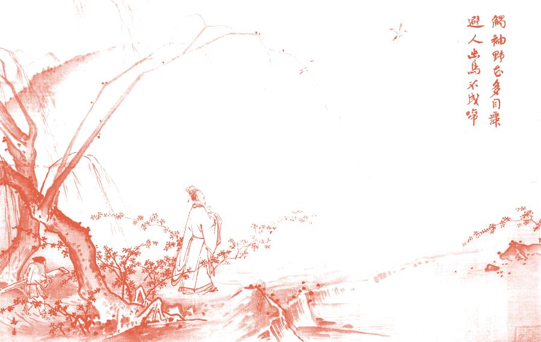

<figure class="sd-art"></figure>
<header class="rs-head">

Taoism · translations compared
<h1>Tao Te Ching, compared</h1>

Old and new translations of five chapters

Chapters 1, 8, 11, 33 and 76. Read with <a href="/tao-te-ching">the edition</a>.

</header>

<nav class="rs-rail" aria-label="Contents">Contents<ol class="rs-toc" data-rs-auto></ol></nav><article class="rs-text">

In brief The same 5 chapters in 5 public-domain translations, one after another, and short samples of 6 modern translations, Red Pine’s first. Legge is the edition. The modern ones are in copyright, so each is quoted for 1 chapter only (Red Pine for 2).

## The translations

In the public domain in the US, quoted for all 5 chapters. Legge first, as the edition, then by date:

- **Legge (1891).** James Legge. We find it the closest to the Chinese of the five. *The Tao Teh King*, in *Sacred Books of the East* vol. 39 (Oxford, 1891). This is [the edition](/tao-te-ching).
- **Carus (1898).** Paul Carus. Renders *Tao* as “Reason”, and sets some passages as rhymed verse. *Lao-Tze’s Tao-Teh-King: Chinese-English* (Chicago: Open Court, 1898).
- **Giles (1904).** Lionel Giles, son of the sinologist Herbert Giles, then an assistant at the British Museum. He arranges the sayings by theme in 9 chapters of his own, and leaves some out; each quotation below says where it comes in his book. *The Sayings of Lao Tzŭ* (London: The Orient Press, 1904).
- **Medhurst (1905).** C. Spurgeon Medhurst, described on his title page as “For Twenty Years a Missionary in China”. A free rendering, with notes comparing other religions. *The Tao Teh King: A Short Study in Comparative Religion* (Chicago: Theosophical Book Concern, 1905).
- **Goddard (1919).** Dwight Goddard, who calls his version “another interpretative translation”. It reads the book as spirit set against matter. *Laotzu’s Tao and Wu Wei* (New York: Brentano’s, 1919).

In copyright, quoted as samples:

- **Red Pine (1996).** Bill Porter, who translates as Red Pine. Each chapter is followed by excerpts from Chinese commentators. *Lao-tzu’s Taoteching* (San Francisco: Mercury House, 1996; revised edition, Copper Canyon Press, 2009). Chapters 1 and 11, from the 1996 edition.
- **Lau (1963).** D. C. Lau. *Lao Tzu: Tao Te Ching* (Penguin, 1963). Chapter 1.
- **Feng and English (1972).** Gia-fu Feng and Jane English. *Tao Te Ching* (New York: Vintage Books, 1972). Chapter 11.
- **Mitchell (1988).** Stephen Mitchell. *Tao Te Ching* (Harper & Row, 1988). Chapter 11.
- **Addiss and Lombardo (1993).** Stephen Addiss and Stanley Lombardo. *Tao Te Ching* (Hackett, 1993). Chapter 11.
- **Le Guin (1997).** Ursula K. Le Guin. *Lao Tzu: Tao Te Ching: A Book about the Way and the Power of the Way* (Shambhala, 1997). Chapter 11.

## Why these five chapters

Chapter 1 is the opening, where each translator first has to choose a word for *Tao*. Chapter 8 is the water passage. Chapter 11 is the wheel, the pot and the room. Chapter 33 is about knowing yourself, and chapter 76 about the hard and the soft. Each is short, so a whole rendering fits on the page.

## Chapter 1: The Tao that can be trodden

### Legge (1891)

> The Tao that can be trodden is not the enduring and unchanging Tao. The name that can be named is not the enduring and unchanging name.
>
> (Conceived of as) having no name, it is the Originator of heaven and earth; (conceived of as) having a name, it is the Mother of all things.
>
> Always without desire we must be found,  
> If its deep mystery we would sound;  
> But if desire always within us be,  
> Its outer fringe is all that we shall see.  
>
> Under these two aspects, it is really the same; but as development takes place, it receives the different names. Together we call them the Mystery. Where the Mystery is the deepest is the gate of all that is subtle and wonderful.

### Giles (1904)

> The Tao which can be expressed in words is not the eternal Tao; the name which can be uttered is not its eternal name. Without a name, it is the Beginning of Heaven and Earth; with a name, it is the Mother of all things. Only one who is eternally free from earthly passions can apprehend its spiritual essence; he who is ever clogged by passions can see no more than its outer form. These two things, the spiritual and the material, though we call them by different names, in their origin are one and the same. This sameness is a mystery,—the mystery of mysteries. It is the gate of all spirituality.

*From Giles’s chapter I, “Tao in its Transcendental Aspect, and in its Physical Manifestation”.*

### Carus (1898)

> THE REASON that can be reasoned is not the eternal Reason. The name that can be named is not the eternal name. The Unnameable is of heaven and earth the beginning. The Nameable becomes of the ten thousand things the mother. Therefore it is said:
>
> “He who desireless is found  
> The spiritual of the world will sound.  
> But he who by desire is bound  
> Sees the mere shell of things around.”
>
> These two things are the same in source but different in name. Their sameness is called a mystery. Indeed, it is the mystery of mysteries. Of all spirituality it is the door.

### Medhurst (1905)

> The Tao which can be expressed is not the unchanging Tao; the name which can be named is not the unchanging name.
>
> The nameless is the beginning of the Heaven Earth [*sic*]; the mother of all things is the nameable.
>
> Thus, while the eternal not-being leads towards the fathomless, the eternal being conducts to the boundary. Although these two have been differently named they come from the same.
>
> As the same they may be described as the abysmal. The abyss of the abysmal is the gate of all mystery.

### Goddard (1919)

> The Tao that can be understood cannot be the primal, or cosmic, Tao, just as an idea that can be expressed in words cannot be the infinite idea.
>
> And yet this ineffable Tao was the source of all spirit and matter, and being expressed was the mother of all created things.
>
> Therefore not to desire the things of sense is to know the freedom of spirituality; and to desire is to learn the limitation of matter. These two things spirit and matter, so different in nature, have the same origin. This unity of origin is the mystery of mysteries, but it is the gateway to spirituality.

*Modern translations, in copyright, quoted as samples.*

### Red Pine (1996)

> The way that becomes a way  
> is not the Immortal Way  
> the name that becomes a name  
> is not the Immortal Name  
> the maiden of Heaven and Earth has no name  
> the mother of all things has a name  
> thus in innocence we see the beginning  
> in passion we see the end  
> two different names  
> for one and the same  
> the one we call dark  
> the dark beyond dark  
> the door to all beginnings  

### Lau (1963)

> The way that can be spoken of  
> Is not the constant way;  
> The name that can be named  
> Is not the constant name.  
>
> The nameless was the beginning of heaven and earth;  
> The named was the mother of the myriad creatures.  
>
> Hence always rid yourself of desires in order to observe its secrets;  
> But always allow yourself to have desires in order to observe its manifestations.  
>
> These two are the same  
> But diverge in name as they issue forth.  
> Being the same they are called mysteries,  
> Mystery upon mystery —  
> The gateway of the manifold secrets.  

## Chapter 8: Water

### Legge (1891)

> The highest excellence is like (that of) water. The excellence of water appears in its benefiting all things, and in its occupying, without striving (to the contrary), the low place which all men dislike. Hence (its way) is near to (that of) the Tao.
>
> The excellence of a residence is in (the suitability of) the place; that of the mind is in abysmal stillness; that of associations is in their being with the virtuous; that of government is in its securing good order; that of (the conduct of) affairs is in its ability; and that of (the initiation of) any movement is in its timeliness.
>
> And when (one with the highest excellence) does not wrangle (about his low position), no one finds fault with him.

### Giles (1904)

> The highest goodness is like water, for water is excellent in benefiting all things, and it does not strive. It occupies the lowest place, which men abhor. And therefore it is near akin to Tao.
>
> The excellence of a dwelling is its site; the excellence of a mind is its profundity; the excellence of giving is charitableness; the excellence of speech is truthfulness; the excellence of government is order; the excellence of action is ability; the excellence of movement is timeliness.

*Giles splits this chapter: the first paragraph is in his chapter II, “Tao as a Moral Principle, or ‘Virtue’”, the second in chapter VIII, “Miscellaneous Sayings and Precepts”. He leaves out the last sentence.*

### Carus (1898)

> Superior goodness resembleth water. Water in goodness benefiteth the ten thousand things, yet it quarreleth not. Because it dwells in places which the multitude of men shun, therefore it is near unto the eternal Reason.
>
> For a dwelling goodness chooses the level. For a heart goodness chooses commotion. When giving, goodness chooses benevolence. In words, goodness chooses faith. In government goodness chooses order. In business goodness chooses ability. In its motion goodness chooses timeliness. It quarreleth not. Therefore, it is not rebuked.

### Medhurst (1905)

> The highest goodness resembles water. Water greatly benefits all things, but does not assert itself.
>
> He approximates to the Tao, who abides by that which men despise.
>
> He revolutionizes the place in which he dwells; his depth is immeasurable; he strengthens moral qualities by what he bestows; he augments sincerity by what he says; he evokes peace by his administration; his transactions manifest ability; he is opportune in all his movements.
>
> Forasmuch as he does not assert himself he is free from blame.

### Goddard (1919)

> True goodness is like water, in that it benefits everything and harms nothing. Like water it ever seeks the lowest place, the place that all others avoid. It is closely kin to the Tao.
>
> For a dwelling it chooses the quiet meadow; for a heart the circling eddy. In generosity it is kind; in speech it is sincere; in authority it is order; in affairs it is ability; in movement it is rhythm.
>
> Inasmuch as it is always peaceable it is never rebuked.

## Chapter 11: The use of emptiness

### Legge (1891)

> The thirty spokes unite in the one nave; but it is on the empty space (for the axle), that the use of the wheel depends. Clay is fashioned into vessels; but it is on their empty hollowness, that their use depends. The door and windows are cut out (from the walls) to form an apartment; but it is on the empty space (within), that its use depends. Therefore, what has a (positive) existence serves for profitable adaptation, and what has not that for (actual) usefulness.

### Giles (1904)

> Thirty spokes unite in one nave; the utility of the cart depends on the hollow centre in which the axle turns. Clay is moulded into a vessel; the utility of the vessel depends on its hollow interior. Doors and windows are cut out in order to make a house; the utility of the house depends on the empty spaces.
>
> Thus, while the existence of things may be good, it is the non-existent in them which makes them serviceable.

*From Giles’s chapter VII, “Paradoxes”.*

### Carus (1898)

> Thirty spokes unite in one nave and on that which is non-existent [on the hole in the nave] depends the wheel's utility. Clay is moulded into a vessel and on that which is non-existent [on its hollowness] depends the vessel's utility. By cutting out doors and windows we build a house and on that which is non-existent [on the empty space] depends the house's utility.
>
> Therefore, when the existence of things is profitable, it is the non-existent in them which renders them useful.

### Medhurst (1905)

> Thirty spokes meet in one hub, but the need for the cart existed when as yet it was not. Clay is fashioned into vessels, but the need for the vessel existed when as yet it was not. Doors and windows are cut to make a house, but the need for the house existed when as yet it was not. Hence there is a profitableness in that which is and a need in that which is not.

### Goddard (1919)

> Although the wheel has thirty spokes its utility lies in the emptiness of the hub. The jar is made by kneading clay, but its usefulness consists in its capacity. A room is made by cutting out windows and doors through the walls, but the space the walls contain measures the room's value.
>
> In the same way matter is necessary to form, but the value of reality lies in its immateriality.
>
> (Or thus: a material body is necessary to existence, but the value of a life is measured by its immaterial soul.)

*Modern translations, in copyright, quoted as samples.*

### Red Pine (1996)

> Thirty spokes converge on a hub  
> but it’s the emptiness  
> that makes a wheel work  
> pots are fashioned from clay  
> but it’s the hollow  
> that makes a pot work  
> windows and doors are carved for a house  
> but it’s the spaces  
> that make a house work  
> existence makes something useful  
> but nonexistence makes it work  

### Feng and English (1972)

> Thirty spokes share the wheel’s hub;  
> It is the center hole that makes it useful.  
> Shape clay into a vessel;  
> It is the space within that makes it useful.  
> Cut doors and windows for a room;  
> It is the holes which make it useful.  
> Therefore profit comes from what is there;  
> Usefulness from what is not there.  

### Mitchell (1988)

> We join spokes together in a wheel,  
> but it is the center hole  
> that makes the wagon move.  
>
> We shape clay into a pot,  
> but it is the emptiness inside  
> that holds whatever we want.  
>
> We hammer wood for a house,  
> but it is the inner space  
> that makes it livable.  
>
> We work with being,  
> but non-being is what we use.  

### Addiss and Lombardo (1993)

> Thirty spokes join one hub.  
> The wheel’s use comes from emptiness.  
>
> Clay is fired to make a pot.  
> The pot’s use comes from emptiness.  
>
> Windows and doors are cut to make a room.  
> The room’s use comes from emptiness.  
>
> Therefore,  
> Having leads to profit,  
> Not having leads to use.  

### Le Guin (1997)

> Thirty spokes  
> meet in the hub.  
> Where the wheel isn’t  
> is where it’s useful.  
>
> Hollowed out,  
> clay makes a pot.  
> Where the pot’s not  
> is where it’s useful.  
>
> Cut doors and windows  
> to make a room.  
> Where the room isn’t,  
> there’s room for you.  
>
> So the profit in what is  
> is in the use of what isn’t.  

## Chapter 33: Knowing oneself

### Legge (1891)

> He who knows other men is discerning; he who knows himself is intelligent. He who overcomes others is strong; he who overcomes himself is mighty. He who is satisfied with his lot is rich; he who goes on acting with energy has a (firm) will.
>
> He who does not fail in the requirements of his position, continues long; he who dies and yet does not perish, has longevity.

### Giles (1904)

> He who knows others is clever, but he who knows himself is enlightened. He who overcomes others is strong, but he who overcomes himself is mightier still. He is rich who knows when he has enough. He who acts with energy has strength of purpose. He who moves not from his proper place is long-lasting. He who dies, but perishes not, enjoys true longevity.

*From Giles’s chapter VII, “Paradoxes”.*

### Carus (1898)

> One who knows others is clever, but one who knows himself is enlightened.
>
> One who conquers others is powerful, but one who conquers himself is mighty.
>
> One who knows sufficiency is rich.
>
> One who pushes with vigor has will, one who loses not his place endures. One who may die but will not perish, has life everlasting.

### Medhurst (1905)

> Who knows men has discernment; who knows himself has illumination.
>
> Who overcomes men has strength; who overcomes himself has determination. Who knows contentment has wealth.
>
> Who acts vigorously has will.
>
> Who never departs from his base, endures long; he dies, but does not perish; he lives eternally.

### Goddard (1919)

> He who knows others is intelligent; he who understands himself is enlightened; he who is able to conquer others has force, but he who is able to control himself is mighty. He who appreciates contentment is wealthy.
>
> He who dares to act has nerve; if he can maintain his position he will endure, but he, who dying does not perish, is immortal.

## Chapter 76: Hard and soft

### Legge (1891)

> Man at his birth is supple and weak; at his death, firm and strong. (So it is with) all things. Trees and plants, in their early growth, are soft and brittle; at their death, dry and withered.
>
> Thus it is that firmness and strength are the concomitants of death; softness and weakness, the concomitants of life.
>
> Hence he who (relies on) the strength of his forces does not conquer; and a tree which is strong will fill the out-stretched arms, (and thereby invites the feller.)
>
> Therefore the place of what is firm and strong is below, and that of what is soft and weak is above.

### Giles (1904)

> Man at his birth is tender and weak; at his death he is rigid and strong. Plants and trees when they come forth are tender and crisp; when dead, they are dry and tough. Thus rigidity and strength are the concomitants of death; softness and weakness are the concomitants of life.
>
> Hence the warrior that is strong does not conquer; the tree that is strong is cut down. Therefore the strong and the big take the lower place; the soft and the weak take the higher place.

*From Giles’s chapter VII, “Paradoxes”.*

### Carus (1898)

> Man during life is tender and delicate. When he dies he is stiff and stark.
>
> The ten thousand things, the grass as well as the trees, are while they live tender and supple. When they die they are rigid and dry. Thus the hard and the strong are the companions of death. The tender and the delicate are the companions of life.
>
> Therefore, he who in arms is strong will not conquer. When a tree has grown strong it is doomed.
>
> The strong and the great stay below. The tender and the delicate stay above.

### Medhurst (1905)

> At birth man is supple and weak, at death rigid and strong. So with inanimate nature—say the vegetable creation—in its early growth it is pliable and brittle, at death it is decayed and withered. It follows that rigidity and strength are the way to death; pliability and gentleness the way to life.
>
> Hence a soldier who is arrogant cannot conquer; the tree which is strong is doomed.
>
> The firm and the great occupy the lower place, the pliable and the meek the higher.

### Goddard (1919)

> When a man is living he is tender and fragile. When he dies he is hard and stiff. It is the same with everything, the grass and trees, in life, are tender and delicate, but when they die they become rigid and dry.
>
> Therefore those who are hard and stiff belong to death's domain, while the tender and weak belong to the realm of life.
>
> Therefore soldiers are most invincible when they will not conquer. When a tree is grown to its greatest strength it is doomed. The strong and the great stay below; the tender and weak rise above.

## What differs

Mostly the key words, and how much each translator adds. For *Tao* in chapter 1 most keep “Tao” or “way”; Carus has “Reason”. In places the sense changes. Goddard’s chapter 1 says the Tao “cannot be the primal, or cosmic, Tao, just as an idea that can be expressed in words cannot be the infinite idea”. Medhurst’s chapter 11 turns the usefulness of the wheel and the pot into “the need for the cart existed when as yet it was not”. Goddard’s chapter 76 says soldiers are “most invincible when they will not conquer”.

In chapter 11 the modern translators keep the three images and part company on the last line: Feng and English’s “Usefulness from what is not there”, Mitchell’s “but non-being is what we use”, Le Guin’s “is in the use of what isn’t”.

## Which to read for what

- **Legge** first, for a close reading. He is the edition, and the only one here in full.
- **Red Pine** for the commentaries: after each chapter he gives excerpts from Chinese commentators.
- **Giles** for the sayings grouped by subject, knowing that the order is his.
- **Medhurst** and **Goddard** to see, as we read them, how far a translator can carry the text towards his own beliefs.
- **Carus** as a curiosity beside Legge, not instead of him: “Reason” for *Tao*, and some passages in rhyme.

## How the quotes were taken

Each quotation was read against the printed page, not only a transcription.

- **Legge:** the edition’s own text, with his paragraph numbers left out.
- **Giles:** Wikisource’s transcription of the 1904 book, checked against its page images on Wikimedia Commons. Three things were wrong in the transcription and are corrected here (“clogged”, not “dogged”, in chapter 1; two stray marks in chapter 11). Giles splits chapter 8 between two of his chapters. He died in 1958, so outside the US his translation is probably in copyright until the end of 2028.
- **Carus, Medhurst and Goddard:** the scans of the 1898, 1905 and 1919 books on archive.org, read from the page images. One word in the scan’s text layer was wrong (Medhurst, chapter 8: “immeasurable”). Medhurst’s “Heaven Earth” in chapter 1 is as printed.
- **The modern samples:** each was read in a scan of the printed book on archive.org or in a copy of the book, and in a second copy where we could find one. The sources we read are recorded in our working notes; we do not link them here.
- Public-domain status is given by publication date, which is the US rule. We have not checked each translator’s status in every country.

## Copyright

Red Pine, Lau, Feng and English, Mitchell, Addiss and Lombardo, and Le Guin are in copyright. Each is quoted for 1 chapter (Red Pine for 2) as a sample, for comparison, with the book named so you can find it. If you hold the rights and want a sample changed or taken down, please [open an issue](https://github.com/life-itself/sutras/issues).

## Wanted, not yet quoted

- **Red Pine in full,** the translation we would most like to publish here. It needs a clean copy of the book and a decision about the rights.
- **Ellen M. Chen** (1989). We found her translation only in copies we could not tie to her printed book, so it is not quoted.

Our notes on this page are CC BY 4.0. The quoted translations are as described above.
</article>

